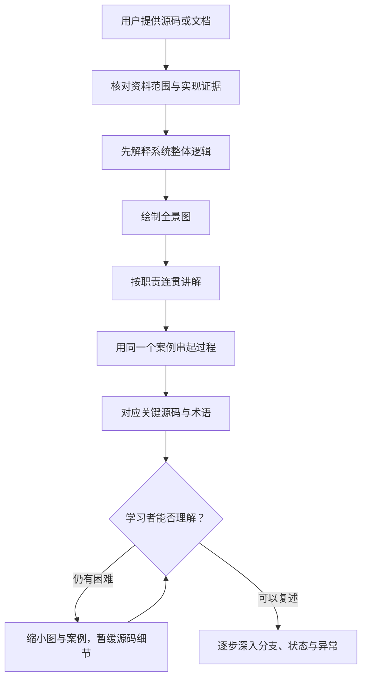

# source-teaching

一个面向编程初学者的中文源码教学 Skill：先理解系统为什么这样运转，再用图、连贯讲解和贯穿案例逐步进入源码。

适用于开源项目导读、Agent 框架学习和技术文档理解。它是一组可复用的教学指令，无需服务器、运行时依赖或独立前端。

## 教学流程



首次必须用到的陌生术语会即时解释，最后再集中对应正式名称。学习者表示不理解时，回到目标与生活案例，不重复堆砌原有术语。

## 文件结构

```text
source-teaching/
├── plugin.json
├── README.md
├── .gitignore
├── LICENSE
├── skills/
│   └── source-teaching/
│       ├── SKILL.md
│       └── LICENSE
└── tests/
    └── validation.md
```

`SKILL.md` 是唯一必需的技能文件；`plugin.json` 用于支持 portable 插件格式的宿主；`LICENSE` 声明仓库许可；测试摘要不参与运行。

## 安装与使用

将 `skills/source-teaching` 整个目录复制到 Codex 用户技能目录 `~/.agents/skills/source-teaching`，或目标项目的 `.agents/skills/source-teaching`。路径中的 `~` 表示当前用户主目录。不同版本的技能发现目录可能不同，请以目标宿主为准。

重新打开聊天并确认可用技能中出现 `source-teaching`，再输入：

```text
$source-teaching
我编程基础薄弱，请根据我提供的源码解释一次请求怎样完成。
源码位置：<实际项目路径>
请先教整体流程，再引导我读关键代码。
```

如果暂未注册技能，可以明确要求助手读取本仓库的 `skills/source-teaching/SKILL.md` 后按其中规则教学。显式读取文件不等于已经安装。

后续反馈示例：

```text
还是不懂，请沿用刚才的案例，解释提出工具请求与真正执行有什么区别。
```

参考：[Codex 技能文档](https://learn.chatgpt.com/docs/build-skills)。

## 许可

本仓库以 [MIT License](LICENSE) 发布，`plugin.json` 的 `license` 字段与 `SKILL.md` 的 `license` frontmatter 同步声明为 `MIT`。技能目录内附有与根目录一致的完整 [LICENSE](skills/source-teaching/LICENSE)。单独复制或分发 `skills/source-teaching` 时，请保留该文件中的版权声明和许可全文；`license: MIT` 仅用于标识许可证，不能替代许可全文。

## 证据边界

教学主要依据用户提供的源码和资料，区分已经实现的功能、文档设计目标、尚未实现的桩代码、教学构造的示例和基于证据的推断。二手材料中的实现描述会标注为“源码未核实”，不会自动当作已实现或设计目标。

静态读码不会被称为运行验证；框架支持某个扩展点，不代表具体项目已经启用。

## 测试与复用

已有一次 Pi Agent Core 0.84.3 学习场景的基线测试、两轮教学测试及修订后复测，详见 [脱敏测试摘要](tests/validation.md)。这些是模型模拟测试，不是学习效果实验。

用新资料测试时：

1. 提供实际入口、关键处理代码及相关文档，记录版本。
2. 保存第一轮回答，检查是否先解释整体、有图、有连贯因果和贯穿案例。
3. 给出一个具体的“还是不懂”反馈，检查是否缩小范围并减少术语。
4. 对照源码核实图中分支、实现边界及引用；记录失败点并修订后复测。

不要只用关键词检查代替人工核对。若环境提供 skill-creator，可使用其 `quick_validate.py` 检查技能格式；格式检查不能证明教学效果。

## 脱敏范围与局限

发布版没有包含原始学习资料、完整本地教学输出、本机绝对路径、个人邮箱、账号专属插件链接或历史 Git 数据。这里保留的是通用规则和概括性测试结论。

本 Skill 不执行被讲解的项目，不保证模型每次遵循全部要求。首轮仍可能对零基础学习者偏长；尚未进行真人测试或多次采样评测。Mermaid 显示依赖宿主，无法显示时可用文字箭头图代替。

